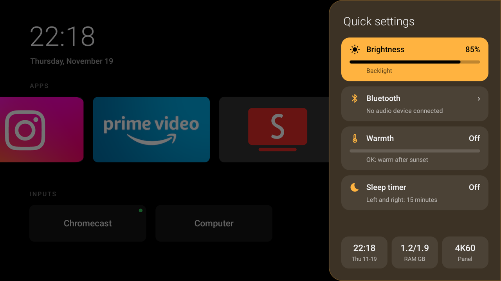
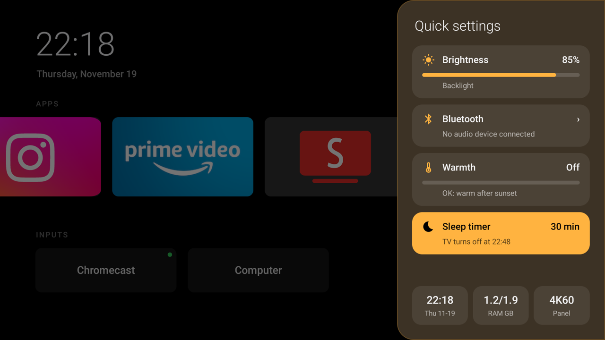

# dumbtv quick settings

An optional panel that slides in from the right when you press the **settings (cog) button on the
remote**, anywhere, or **☰ Menu** while an HDMI input is on screen. Press the cog again to close it.
dumbtv home's on-screen Settings chip still opens the TV's settings.

The remote's cog never reaches an app: Fire OS's key policy sends it as a global-button broadcast
to Amazon's quick settings. This panel reads the press from the log and switches on Amazon's own
`quick_settings_lock`, which makes Amazon's quick settings ignore the cog, so Amazon's panel never
opens behind or over this one. **Holding HOME still opens Amazon's panel.** Without this app
installed, with **Options › Quick settings panel** off (it is on by default), or with home locked,
the lock is off and the cog shows Amazon's panel as before. See "Amazon's quick settings" below.

<p align="center">
  
</p>
<p align="center">
  
  
</p>

| Row | Left / right | OK |
|---|---|---|
| Brightness | backlight in 5 % steps (day or night level) | switches **dim after sunset** on/off |
| Bluetooth | cycles paired audio devices, then Settings… | connects or disconnects device; on Settings… opens Bluetooth screen |
| AirPlay | | glance: Ready / In use / "Macs can't see the TV, restart it"; OK makes room (`killBackgroundProcesses`, never AirPlay) |
| Picture off | | turns screen black + min backlight (sound continues); any key restores |
| Network | | glance: Filter on/off + Wi-Fi signal/band; OK restarts DNS filter |
| TV health | | only with an expected state ([expected.example.conf](expected.example.conf)): All as set, or the first problem; OK cycles through them |
| Auto-switch | on / paused until 06:00 / off | only from home, and only where home opens an input when idle (`idle_input`): pauses that switch |
| Warmth | cold to warm in 10 % steps | switches between always on, **after sunset only**, and **off till next sunset** |
| Sleep timer | 15-minute steps, up to 4 hours | |
| Noise level | | live ambient dB bar while panel is open; only with `install.sh --mic` and a built-in mic (AFTHY7ABBA: its built-in mic route reads only zeros, so the row stays off there) |

At the bottom: the time and date, memory in use, and the video format. Over an HDMI input that is
the signal (`1080p60`, `SDR · HDMI`); over the home screen it is the panel's own mode (`4K60`).
BACK or Menu slides the panel away.

## Install

```sh
ADB_SERIAL=<tv-ip>:5555 ./quick/install.sh          # build, install, grant
ADB_SERIAL=<tv-ip>:5555 ./quick/install.sh --undo   # give up the device admin, uninstall
```

It is signed with dumbtv home's key (`launcher/release.keystore`), so build dumbtv home first.
`scripts/restore.sh` removes it too.

## Why a separate app

dumbtv home asks for one permission on Fire OS 7 and 8, and CI holds it to that. The panel needs
several, so they go to this app alone. None of them can be granted on the TV; `install.sh` grants
each over adb:

| For | Grant | Why |
|---|---|---|
| Brightness | `appops set tv.dumbtv.quick WRITE_SETTINGS allow` | writes `system screen_brightness`, which the TV's display driver applies to the backlight |
| Warmth & Picture off | `appops set tv.dumbtv.quick SYSTEM_ALERT_WINDOW allow` | tinted window and black overlay over every app and input |
| Video format & AirPlay | `pm grant tv.dumbtv.quick android.permission.READ_LOGS` | reads `DispService` tag and events log buffer for AirPlay process lifecycle |
| Sleep timer | `dpm set-active-admin tv.dumbtv.quick/.Admin` | `DevicePolicyManager.lockNow()`, the remote's standby; force-lock is its only policy |
| The cog | `pm grant tv.dumbtv.quick android.permission.WRITE_SECURE_SETTINGS` | sets `secure quick_settings_lock`, Amazon's own switch for its quick settings, while the panel replaces it; `install.sh --undo` and `scripts/restore.sh` delete it |
| Noise meter | `pm grant tv.dumbtv.quick android.permission.RECORD_AUDIO` (`install.sh --mic`) | samples the built-in mic only while the panel is open; nothing recorded or saved. Plain `MIC` routes to the remote's BLE mic, which sends nothing unless the voice button is held, so `Noise` asks for `TYPE_BUILTIN_MIC` |

Normal permissions granted at install include `BLUETOOTH`, `BLUETOOTH_ADMIN` (connect/disconnect audio), `KILL_BACKGROUND_PROCESSES` (AirPlay make-room), `ACCESS_WIFI_STATE`, `ACCESS_NETWORK_STATE` (Wi-Fi glance), `RECEIVE_BOOT_COMPLETED` (restart filter broadcast). It has no `INTERNET` permission.

## How it works, and the limits found on a Fire TV television (AFTHY7ABBA, Fire OS 8.1)

- **Brightness is per source with dim after sunset.** The TV keeps a backlight level for each input
  in its picture settings and writes it to `screen_brightness` when the input changes. The panel
  remembers its own level for HDMI and for apps and home, and writes it back just after the TV does.
  When auto-dim is on, day and night levels are kept per source and blended with `Sun.night()`.
- **Warmth and Picture off are overlays.** A window is the only display control accessible to a
  normal app. Picture off draws an opaque black overlay with minimum backlight while sound keeps
  playing; any remote key except volume restores the picture.
- **After sunset** is worked out on the TV offline, with no network or location permission: the place
  comes from the time zone (a table of common zones, otherwise the UTC offset at 40° N), and the
  times from the US Naval Observatory sunrise equation. Warmth fades in over 30 minutes after
  sunset and out over the 30 minutes before sunrise.
- **The video format and AirPlay** come from the log. DispService logs HDMI input modes. The events
  buffer tracks the AirPlay player process (`com.apple.airplay.amazon.airplay`) and daemon
  (`com.amazon.airplaydaemon`), matched on the process-name field only (`AirPlay.java`).
- **Amazon's quick settings** (`com.amazon.tv.quicksettings.ui`, `AmazonQs.java`). The cog goes
  `GLOBAL_BUTTON` → `com.amazon.tv.quicksettings` → `SETTING_BUTTON_PRESSED` →
  `QSLaunchButtonPressReceiver`, which toggles the overlay service unless `secure
  quick_settings_lock` is 1. Both broadcasts are aimed at Amazon's packages and need signature
  permissions, so no app can catch or stop them; the lock is the one switch an app can set. The
  overlay service also announces itself: `com.amazon.tv.quicksettings.demo.ACTION_OVERLAY_INTENT_VISIBILITY`,
  an unprotected broadcast for the store demo, says `Hide` when it starts and `Show` when it
  stops, so the panel knows whether Amazon's overlay is really up.
  - The lock is on while the panel replaces Amazon's and Amazon's overlay is not up. While it is up,
    the cog reaches it and closes it as it always did, as the panel opens.
  - Holding HOME goes to the same receiver, and nothing outside Amazon can open its overlay on Fire
    OS 8: `GLOBAL_BUTTON` is a protected broadcast, every other way in needs a signature permission,
    and the launcher's `QuickSettingsProxyActivity` works only from SDK 34. So the panel watches for
    the long press in the log (`LogLines.java`: PhoneWindowManager's "Undefined home long press
    behavior" and Fire OS's `sendLongHomeBroadcasts` stack) and takes the lock off for 1.5 s. The
    lock comes off within 10 ms of the line, and Amazon reads it 25 ms or more after it, and reads
    it twice when locked (its first receiver hands the press back), so the race has room. It is
    still a race.
  - If Amazon's overlay starts anyway (an update ignores the lock, the grant is missing, or the
    first press after the lock was off), Guard's window event raises the panel above it with a
    snapshot covering the swap, so nothing flashes. Once the panel closes, Guard sends one BACK,
    and only while Amazon's broadcast says its overlay is up. A BACK on anything else would leave
    the app or HDMI input. Closing with the cog needs no BACK: that press closes Amazon's too.
  - Tried and dropped: `killBackgroundProcesses` on Amazon's packages (refused: package
    visibility); `appops … SYSTEM_ALERT_WINDOW ignore` (Amazon keeps toggling an invisible window,
    so every other press is lost); sending Amazon's own `GLOBAL_BUTTON` or `DISMISS_QUICKSETTINGS_UI`
    (protected and signature-only).
- **The sleep timer** is an exact alarm. An active device admin cannot be uninstalled, and
  `dpm remove-active-admin` only removes test admins, so `install.sh --undo` first asks the app
  to give it up (`Undo`, a receiver only adb's shell can reach).

## Files

| | |
|---|---|
| `Panel.java` | the panel and its rows (scrollable on 540 dp screens) |
| `Tint.java` | foreground service: warmth overlay, picture off, the cog and Amazon's quick settings, DispService & event log, sunset tick |
| `AmazonQs.java` | Amazon's quick settings: its lock and its visibility broadcast |
| `LogLines.java` | the cog and a long press of HOME in the log (tests: `tests/LogLinesTest.java`) |
| `Backlight.java` | brightness per source with day/night auto dim |
| `Network.java` | filter on/off and Wi-Fi band/RSSI check |
| `Health.java` | TV health expected-state checker (tests: `tests/HealthTest.java`) |
| `Noise.java` | live AudioRecord RMS dB meter |
| `AirPlay.java` | AirPlay state from `am_proc_start`/`am_proc_died` (tests: `tests/AirPlayTest.java`) |
| `Video.java` | DispService log parser (tests: `tests/VideoTest.java`) |
| `Sun.java` | sunrise, sunset, and dim blend (tests: `tests/SunTest.java`) |
| `Sleep.java`, `Admin.java` | sleep timer |
| `Boot.java`, `Undo.java`, `Compat.java` | start at boot, uninstall hook, Android 8 calls by reflection |
