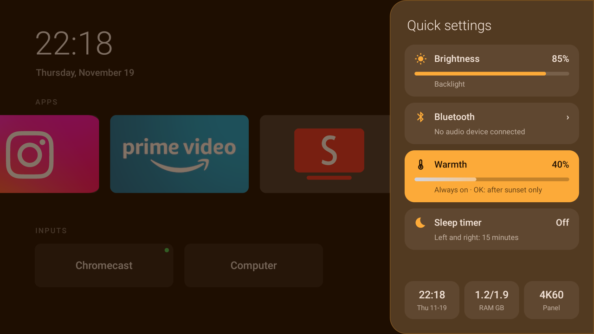

# dumbtv quick settings

An optional panel that slides in from the right when you press dumbtv home's **Settings** chip
(the cog), or **☰ Menu** while an HDMI input is on screen. Without it installed, the cog opens
the TV's settings as before. Holding HOME still opens Fire OS's own quick menu.

<p align="center">
  
</p>
<p align="center">
  
  
</p>

| Row | Left / right | OK |
|---|---|---|
| Brightness | backlight in 5 % steps | |
| Bluetooth | | opens the TV's Bluetooth screen; the row shows the audio device that is connected |
| Warmth | cold to warm in 10 % steps | switches between always on and **after sunset only** |
| Sleep timer | 15-minute steps, up to 4 hours | |

At the bottom: the time and date, memory in use, and the video format. Over an HDMI input that is
the signal (`1080p60`, `SDR · HDMI`); over the home screen it is the panel's own mode (`4K60`).
BACK or Menu slides the panel away.

## Install

```sh
ADB_SERIAL=<tv-ip>:5555 ./quick/install.sh          # build, install, grant
ADB_SERIAL=<tv-ip>:5555 ./quick/install.sh --undo   # give up the device admin, uninstall
```

It is signed with dumbtv home's key (`launcher/release.keystore`), so build dumbtv home first.
`scripts/restore.sh` removes it too.

## Why a separate app

dumbtv home asks for one permission on Fire OS 7 and 8, and CI holds it to that. The panel needs
several, so they go to this app alone. None of them can be granted on the TV; `install.sh` grants
each over adb:

| For | Grant | Why |
|---|---|---|
| Brightness | `appops set tv.dumbtv.quick WRITE_SETTINGS allow` | writes `system screen_brightness`, which the TV's display driver applies to the backlight |
| Warmth | `appops set tv.dumbtv.quick SYSTEM_ALERT_WINDOW allow` | a tinted window over every app and input |
| Video format | `pm grant tv.dumbtv.quick android.permission.READ_LOGS` | reads one log tag, MediaTek's `DispService` |
| Sleep timer | `dpm set-active-admin tv.dumbtv.quick/.Admin` | `DevicePolicyManager.lockNow()`, the remote's standby; force-lock is its only policy |

It has no `INTERNET` permission. Bluetooth (the normal `BLUETOOTH` permission) is only read.

## How it works, and the limits found on a Fire TV television (AFTHY7ABBA, Fire OS 8.1)

- **Brightness is per source.** The TV keeps a backlight level for each input in its picture
  settings and writes it to `screen_brightness` when the input changes. The panel remembers its
  own level for HDMI and for apps and home, and writes it back just after the TV does. A change
  made in the TV's own picture settings is kept as the new level.
- **Warmth is an overlay.** Fire OS reports Night display as not available, and the MediaTek
  picture service is signature-only, so there is no colour filter for a normal app. A window can
  only blend, so warmth also lifts blacks a little; the strongest setting is held to 32 %
  opacity. The overlay is composed by the hardware composer above the HDMI video plane, so it
  covers inputs as well as apps.
- **After sunset** is worked out on the TV, with no network or location permission: the place
  comes from the time zone (a table of common zones, otherwise the UTC offset at 40° N), and the
  times from the US Naval Observatory sunrise equation. Warmth fades in over 30 minutes after
  sunset and out over the 30 minutes before sunrise.
- **The video format** comes from the log. `TvView.getTracks()` returns no video track for an
  HDMI input on MediaTek TVs, but the display service logs every stream it creates
  (`realInFmt[1920x1080, fps(60000, 0), ... Hdr SDR] ... realHdmiFps 59940`). A foreground
  service follows that tag from boot. Older lines are not used: logd prunes the chattiest
  process first, so a stream's end can be gone while its start is still in the buffer.
- **The sleep timer** is an exact alarm. An active device admin cannot be uninstalled, and
  `dpm remove-active-admin` only removes test admins, so `install.sh --undo` first asks the app
  to give it up (`Undo`, a receiver only adb's shell can reach).

## Files

| | |
|---|---|
| `Panel.java` | the panel and its rows |
| `Tint.java` | foreground service: warmth overlay, DispService log, sunset tick |
| `Backlight.java` | brightness per source |
| `Video.java` | DispService log parser (tests: `tests/VideoTest.java`) |
| `Sun.java` | sunrise and sunset (tests: `tests/SunTest.java`) |
| `Sleep.java`, `Admin.java` | sleep timer |
| `Boot.java`, `Undo.java`, `Compat.java` | start at boot, uninstall hook, Android 8 calls by reflection |
